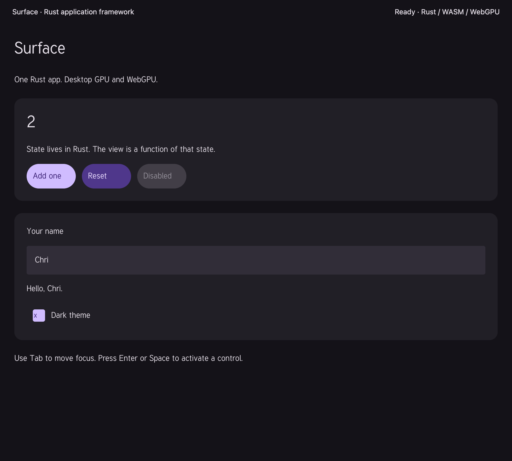
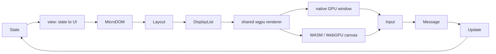

# Surface

A Rust app framework built around **UI = f(state)** and a small semantic
MicroDOM. One application supplies the state, messages, and view. The same
GPU renderer paints it in a native window or a browser canvas.

This is the first working framework version. It includes a Material
3-inspired component set, not the full Material component specification.

The current main-branch landing is
[surface@0.1.0](https://github.com/faberline/surface/milestone/1).
[surface@0.2.0](https://github.com/faberline/surface/milestone/2) tracks the
full component and platform target. See [delivery stages](docs/delivery-stages.md)
for every follow-up issue. Native OS Zhuyin verification remains deferred.



## Run the example

Tested with Rust 1.96.1 through rustup. Put its shims before Homebrew's Rust on macOS.
Local builds use `cap` and two build jobs.

```sh
export PATH="$HOME/.cargo/bin:$PATH"
export CARGO_BUILD_JOBS=2
cap cargo run --locked -p surface-showcase
```

For the browser:

```sh
rustup target add wasm32-unknown-unknown
cargo install wasm-bindgen-cli --version 0.2.129 --locked
brew install binaryen   # wasm-opt, for release builds
cargo xtask web dev showcase
```

Open `http://127.0.0.1:8080` in a browser with WebGPU. The page reloads
after each successful rebuild. `cargo xtask web build showcase` makes a
release package in `target/web/release/showcase`, and
`cargo xtask web serve showcase` serves it. See [web build](docs/web-build.md). Production hosting
needs HTTPS. The only HTML UI host is a canvas. Layout, components, state,
input routing, and drawing run in Rust/WASM.

The showcase supports a counter, reset, disabled controls, text input,
keyboard focus, scrolling, and a light/dark theme. Both hosts use the same
[`Showcase`](examples/showcase/src/lib.rs) implementation.

Run the larger component gallery:

```sh
cap cargo run --locked -p surface-material-gallery
```

For WebGPU, run `cargo xtask web dev material-gallery`. It includes controlled selections,
sliders, button/chip variants, menus and an editable dialog.
Both themes use a generated Material color scheme.

## Export the current DOM

`runtime.export_dom()?` returns JSON with the current semantic tree,
styles, optional layout, focus, pointer state and text editing state.
`runtime.snapshot()` returns the typed value. The browser gallery exposes
the same call as `window.gallery.export_dom()`.
See [DOM export](docs/dom-export.md) for file and browser download examples.

Enable `surface-platform`'s optional `devtools` feature for desktop or WASM
CLI/MCP access through the independent Jet bridge. Both hosts use the same
seven semantic operations. They read the Rust tree and send normal state
updates. Surface imports only the small protocol crate. See the
[application bridge](docs/application-bridge.md) for setup and live tests.

## Write an app

```rust,no_run
use surface_app::{Application, View};
use surface_material::Theme;

#[derive(Default)]
struct Counter { count: u32 }

#[derive(Clone)]
enum Message { Add }

impl Application for Counter {
    type Message = Message;

    fn update(&mut self, message: Message) {
        match message { Message::Add => self.count += 1 }
    }

    fn view(&self) -> View<Message> {
        let theme = Theme::light();
        theme.page([
            theme.heading("count", self.count.to_string()),
            theme.button("add", "Add one", Message::Add),
        ])
    }
}

fn main() -> Result<(), surface_platform::HostError> {
    surface_platform::run(Counter::default())
}
```

Add `surface-app`, `surface-material`, and `surface-platform` from this
workspace to your app. The repository has no dependency on Core or Jet.
The crates are not yet published on crates.io.

`view(&self)` describes the current UI. Keep it pure: no network calls,
state writes, timers, or platform work. Compose components as Rust functions
that return `View<Message>`. Events produce messages. `update` changes
state. The runtime then builds a fresh semantic tree. Stable control IDs
preserve focus across updates. A retained layout engine reuses unchanged
measurements. Renderer resources stay outside application state.

## Packages

| Package | Responsibility |
| --- | --- |
| `surface` | Existing Element API, compact MicroDOM arena, semantic lookup, typed style, retained layout, geometry, hit testing, display list |
| `surface-app` | Pure views, messages, Unicode editing, modal focus, roving groups, sliders, scroll state and DOM export |
| `surface-material` | Seeded light/dark color roles, text, cards, button/chip variants, selections, slider, tabs, menus, dialogs and controlled text fields |
| `surface-wgpu` | Rounded rectangle shader, embedded font, shared text shaping, clipped GPU painting in display-list order |
| `surface-platform` | Native window and browser canvas hosts, GPU surface setup, resize/DPI handling, platform event translation |
| `ui-runtime` | Existing hooks API imported from Core for compatibility; independent of the new application API |
| `surface-showcase` | One application built as a desktop binary or WASM library |
| `surface-material-gallery` | Shared desktop/WebGPU component gallery and behavior examples |



## Verify

```sh
./scripts/check.sh
./scripts/check-gpu.sh
cap cargo run --locked -p surface-showcase -- --smoke
```

The first script checks source provenance, format, Rust behavior, native
compilation, and WASM compilation. Its WASM step also builds `ui-runtime`
with and without `debug`, plus the consumer contract test that pins the API
Jet and Core use. The second explicitly runs the GPU pixel test. It fails when
an adapter is unavailable. The desktop smoke run creates a real window,
paints two frames, and exits. `cargo xtask web e2e` builds the web and
native inputs and runs the browser and bridge end-to-end tests in
[`e2e/`](e2e). It needs Chrome; see
[verification](docs/verification.md#re-run-the-browser-tests).

## Current limits

- Material components cover the controls listed above. Full family and
  variant coverage, elevation, ripples, heavier font faces, rendered letter
  spacing and the rest of motion remain open.
  See the [component record](docs/material-coverage.json) and
  [Material API notes](docs/material.md).
- Text editing includes caret/selection, clipboard, grapheme deletion,
  undo/redo, Chinese font coverage and preedit/commit/cancel handling.
  Browser composition is tested. The native OS candidate-popup journey,
  other desktop platforms and mobile keyboards still need runtime evidence.
  See [text input](docs/text-input.md).
- Semantic roles support tests. Native screen-reader bridges and an
  accessible HTML companion tree remain planned.
- Flexbox, wrapping, clipping, scroll offsets, and ordered paint are present.
  Images, transforms, and a general CSS engine are not included.
  Animation is limited to color and corner transitions with reduced motion.
  Springs, layout animation and enter/exit animation are not included. See
  [Material motion](docs/material.md#motion).
- Application state is explicit. Async commands and keyed local component
  state need a separate design. The legacy hooks package is retained, but
  it is not connected to `View<Message>`.
- macOS and browser runtime checks are separate from Windows/Linux build
  and runtime qualification. See [verification](docs/verification.md).

See [architecture](docs/architecture.md), [migration](docs/migration.md),
and [remaining work](docs/roadmap.md).

## Origin and license

`surface` and `ui-runtime` started as MIT-licensed packages from
[`faberline/core`](https://github.com/faberline/core) at
`41c352eaae687a1914087d279f36adbe9e9b4af5`.
The source inventory is in [`docs/provenance.json`](docs/provenance.json).
`cargo xtask provenance` checks its hashes.
It hashes only the source files imported from Core and the pinned fonts.
Imported source files changed since the import are listed there with a
reason.
Jet supplies the public-domain Tuffy font and reference layout concepts.
No Jet renderer or application code is linked. Font attribution is in
[`assets/LICENSE.txt`](crates/surface-wgpu/assets/LICENSE.txt).

MIT. See [LICENSE](LICENSE).
